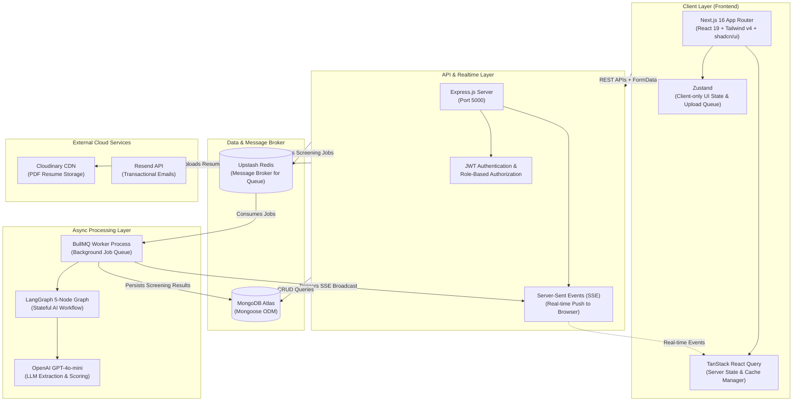
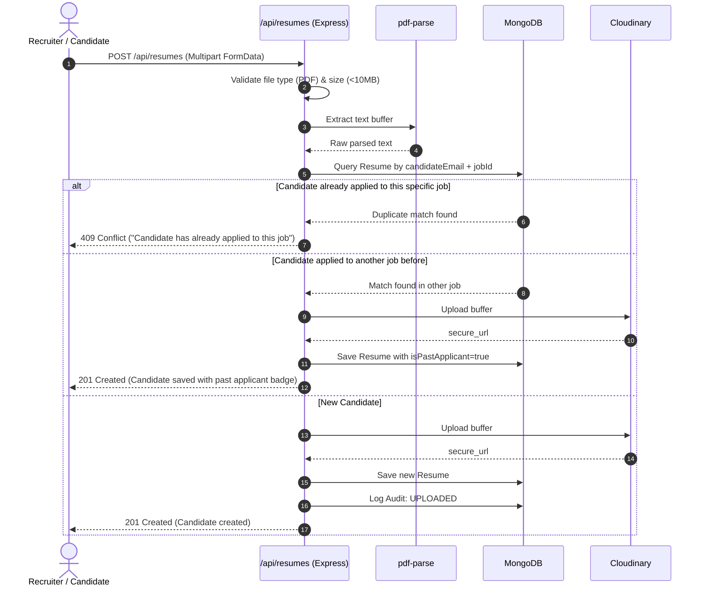
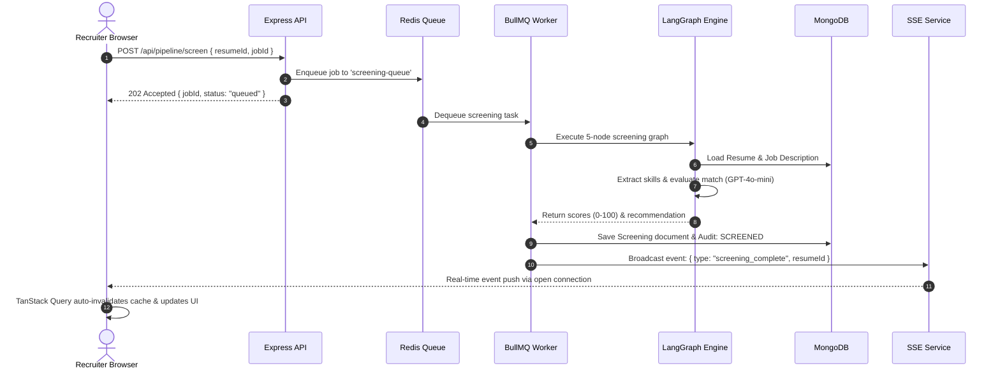

# Technical Architecture & System Design — ResumeLens

**Version:** 2.0  
**Stack:** Next.js 16 + Node.js/Express + MongoDB + Redis/BullMQ + LangChain/LangGraph + OpenAI

---

## 1. High-Level System Architecture



---

## 2. Technology Stack Breakdown

| Layer | Technology | Version | Purpose |
| :--- | :--- | :--- | :--- |
| **Frontend Framework** | Next.js (App Router) | 16.1.6 | Server-side rendering, routing, layouts, and static optimization |
| **UI Library** | React | 19.2.3 | Core component library |
| **Styling** | Tailwind CSS v4 + tw-animate-css | 4.1.18 | Modern utility-first CSS using OKLCH color tokens |
| **Component Kit** | shadcn/ui + Radix UI Primitives | 3.8.5 | Accessible, customizable UI primitives (Dialog, Select, Avatar, Cards) |
| **Server State Management** | TanStack React Query | 5.x | Server-state caching, automatic background revalidation, query invalidation |
| **Client UI State** | Zustand | 5.0.11 | Ephemeral client UI state (auth session, upload progress queue) |
| **Icons** | Lucide React | 0.574.0 | Consistent modern iconography |
| **Notifications** | Sonner | 2.0.7 | Toast notification engine |
| **Backend Framework** | Node.js + Express.js | 4.21.x | REST API server, security middlewares, routing |
| **Database** | MongoDB Atlas | 7.x | Document database for jobs, candidates, screenings, audit logs |
| **ODM** | Mongoose | 8.8.x | Schema modeling, validation, subdocuments, and query population |
| **Message Broker** | Upstash Redis | 7.x | Cloud Redis instance backing BullMQ queues |
| **Background Queue** | BullMQ | 5.34.x | Job queuing, worker management, retries, concurrency limits |
| **AI Orchestration** | LangChain + LangGraph | 0.3.x | Multi-node stateful workflow graphs, prompt templates, output parsers |
| **LLM Model** | OpenAI GPT-4o-mini | - | Entity extraction, scoring, email drafting, chat copilot |
| **File Storage** | Cloudinary | 2.x | Cloud storage for applicant PDF resumes |
| **Transactional Email** | Resend | 4.x | Recruiter-to-candidate email delivery |
| **PDF Parsing** | `pdf-parse` | 1.1.x | In-memory raw text extraction from uploaded PDF buffers |

---

## 3. Project Directory Structure

```text
recruitai-project/
├── backend/
│   ├── src/
│   │   ├── agents/
│   │   │   └── screeningGraph.js        # 5-node LangGraph autonomous screening state machine
│   │   ├── config/
│   │   │   ├── db.js                    # MongoDB Mongoose connection manager
│   │   │   ├── redis.js                 # Upstash Redis client configuration
│   │   │   └── cloudinary.js            # Cloudinary SDK credentials & uploader
│   │   ├── controllers/
│   │   │   ├── adminController.js       # User management, role elevation, system audits
│   │   │   ├── authController.js        # Signup, login, logout, me, refresh token
│   │   │   ├── jobsController.js        # Job CRUD, AI JD generation, team assignment
│   │   │   ├── notificationController.js# User notification inbox and read status
│   │   │   ├── pipelineController.js    # Enqueue candidate screening jobs to BullMQ
│   │   │   ├── publicController.js      # Public careers apply & candidate status tracker
│   │   │   ├── questionsController.js   # AI interview question generation
│   │   │   ├── resumeController.js      # Resume upload, PDF parse, deduplication, talent pool query
│   │   │   ├── screeningController.js   # Candidate scoring, stages, decision, teamNotes, auditLogs
│   │   │   ├── statsController.js       # Dashboard KPI analytics, hiring funnel metrics
│   │   │   └── usersController.js       # Recruiter profile and team queries
│   │   ├── middleware/
│   │   │   ├── authMiddleware.js        # JWT token verification (protect) & RBAC guard (authorize)
│   │   │   ├── errorMiddleware.js       # Centralized error handler & CustomError class
│   │   │   └── uploadMiddleware.js      # Multer memory-storage configuration for PDFs
│   │   ├── models/
│   │   │   ├── auditLogModel.js         # Immutable chronological candidate activity log
│   │   │   ├── interviewQuestionModel.js# Generated technical & behavioral questions
│   │   │   ├── jobModel.js              # Job requisition schema with assigned recruiters
│   │   │   ├── notificationModel.js     # User in-app notifications
│   │   │   ├── organizationModel.js     # Tenant/Company organization reference
│   │   │   ├── processingJobModel.js    # BullMQ job status tracker in MongoDB
│   │   │   ├── resumeModel.js           # Candidate profile, parsed skills, Cloudinary URL
│   │   │   ├── screeningModel.js        # AI scores, recommendation, pipeline stage, teamNotes
│   │   │   └── userModel.js             # User accounts with bcrypt password hashes & roles
│   │   ├── routes/
│   │   │   ├── adminRoutes.js           # /api/admin/*
│   │   │   ├── authRoutes.js            # /api/auth/*
│   │   │   ├── jobsRoutes.js            # /api/jobs/*
│   │   │   ├── notificationRoutes.js    # /api/notifications/*
│   │   │   ├── pipelineRoutes.js        # /api/pipeline/*
│   │   │   ├── publicRoutes.js          # /api/public/*
│   │   │   ├── questionsRoutes.js       # /api/questions/*
│   │   │   ├── resumeRoutes.js          # /api/resumes/*
│   │   │   ├── screeningRoutes.js       # /api/screening/*
│   │   │   ├── statsRoutes.js           # /api/stats/*
│   │   │   └── usersRoutes.js           # /api/users/*
│   │   ├── services/
│   │   │   ├── backgroundQueue.js       # BullMQ queue definition & worker setup
│   │   │   ├── biasDetectionAgent.js    # Bias evaluation logic
│   │   │   ├── candidateChatAgent.js    # LangChain agent for recruiter-candidate Q&A
│   │   │   ├── emailDraftAgent.js       # Contextual email generation
│   │   │   ├── emailService.js          # Resend API email sender
│   │   │   ├── entityExtractorAgent.js  # Resume information parsing agent
│   │   │   ├── jdAnalyzerAgent.js       # Job description qualification analyzer
│   │   │   ├── jdGeneratorAgent.js      # AI JD generation agent
│   │   │   ├── pdfParserService.js      # pdf-parse wrapper
│   │   │   ├── questionGeneratorAgent.js# Tailored interview question generator
│   │   │   ├── resumeScorerAgent.js     # 3-dimensional resume scoring agent
│   │   │   ├── sseService.js            # Server-Sent Events subscriber manager & broadcast
│   │   │   └── validationService.js     # Schema validation and sanitization helpers
│   │   └── index.js                     # Express app bootstrap, CORS, cookie-parser, routes mount
│   └── package.json
│
├── frontend/
│   ├── src/
│   │   ├── app/
│   │   │   ├── (auth)/                  # Login, Signup, Reset-password routes
│   │   │   ├── (dashboard)/
│   │   │   │   ├── admin/users/         # Admin user management console
│   │   │   │   ├── candidates/          # Centralized Talent Pool Directory
│   │   │   │   ├── dashboard/           # Main executive recruiter dashboard
│   │   │   │   ├── jobs/                # Jobs listing, creation, and detail views
│   │   │   │   │   └── [jobId]/screening/# Candidate Kanban Pipeline Board
│   │   │   │   ├── screening/[screeningId]/ # Candidate Evaluation, Team Notes, Timeline, PDF View
│   │   │   │   ├── settings/            # Recruiter personal profile & organization settings
│   │   │   │   └── layout.jsx           # Authenticated shell layout (Navbar + Sidebar)
│   │   │   ├── apply/[jobId]/           # Public candidate application careers portal
│   │   │   ├── status/[resumeId]/       # Public candidate self-service status tracker
│   │   │   ├── globals.css              # Tailwind CSS v4 design tokens and theme variables
│   │   │   └── layout.js                # Root HTML layout with Providers
│   │   ├── components/
│   │   │   ├── common/                  # LoadingSpinner, ErrorBoundary, EmptyState
│   │   │   ├── dashboard/
│   │   │   │   ├── audit-timeline.jsx   # Candidate activity audit timeline with NOTE_ADDED support
│   │   │   │   ├── candidate-chat.jsx   # Floating AI copilot chat widget
│   │   │   │   ├── candidate-kanban.jsx # 5-stage interactive pipeline board
│   │   │   │   ├── candidate-notes.jsx  # Collaborative team recruiter notes feed & composer
│   │   │   │   ├── job-card.jsx         # Job summary cards
│   │   │   │   ├── questions-display.jsx# AI interview questions list
│   │   │   │   ├── resume-upload.jsx    # Drag-and-drop resume uploader with validation
│   │   │   │   ├── score-breakdown.jsx  # Visual radar/bar score breakdown
│   │   │   │   └── score-gauge.jsx      # Circular match score gauge
│   │   │   ├── layout/                  # DashboardNavbar, Sidebar, UserMenu
│   │   │   └── ui/                      # 27+ shadcn/ui components (Card, Button, Dialog, etc.)
│   │   ├── hooks/
│   │   │   ├── use-auth.js              # Authentication state and login/logout mutations
│   │   │   ├── use-jobs.js              # Job queries and mutations
│   │   │   ├── use-resume.js            # Resume upload and talent pool queries
│   │   │   ├── use-screening.js         # Screening, Kanban stage, notes, and audit-log hooks
│   │   │   └── use-sse.js               # EventSource connection listener for real-time updates
│   │   └── lib/
│   │       ├── api-client.js            # Axios client with base URL and withCredentials
│   │       └── utils.js                 # cn() class merging helper and formatters
│   └── package.json
```

---

## 4. Database Schema Specifications

### 4.1. `User` Schema (`userModel.js`)
- `name`: String (Required)
- `email`: String (Required, Unique, Lowercase, Indexed)
- `password`: String (Required, bcrypt hashed)
- `role`: Enum `["admin", "hiring_manager", "recruiter"]` (Default: `"recruiter"`)
- `organization`: ObjectId ➔ `Organization`
- `createdAt`, `updatedAt`: Timestamps

### 4.2. `Job` Schema (`jobModel.js`)
- `title`: String (Required, Indexed)
- `description`: String (Required)
- `company`: String (Required)
- `department`: String
- `location`: String (e.g., "Remote", "San Francisco, CA")
- `type`: Enum `["full-time", "part-time", "contract", "internship"]`
- `experienceLevel`: Enum `["entry", "mid", "senior", "lead", "executive"]`
- `salaryRange`: `{ min: Number, max: Number, currency: String }`
- `status`: Enum `["draft", "published", "closed"]` (Default: `"published"`)
- `createdBy`: ObjectId ➔ `User` (Required)
- `assignedTo`: `[ObjectId ➔ User]` (Recruiters with scoped access)
- `requirements`: `[String]`
- `createdAt`, `updatedAt`: Timestamps

### 4.3. `Resume` Schema (`resumeModel.js`)
- `candidateName`: String (Required)
- `candidateEmail`: String (Required, Lowercase, Indexed)
- `candidatePhone`: String
- `fileUrl`: String (Cloudinary secure delivery HTTPS URL)
- `filePublicId`: String (Cloudinary asset ID)
- `parsedText`: String (Raw text extracted via `pdf-parse`)
- `extractedSkills`: `[String]` (Extracted by AI)
- `experienceYears`: Number
- `jobId`: ObjectId ➔ `Job` (Required, Indexed)
- `uploadedBy`: ObjectId ➔ `User` (Null if submitted via public portal)
- `isPastApplicant`: Boolean (Default: `false`, deduplication flag)
- `pipelineStage`: Enum `["applied", "screening", "interview", "offered", "hired", "rejected"]` (Default: `"applied"`)
- `createdAt`: Date (Default: `Date.now`)

### 4.4. `Screening` Schema (`screeningModel.js`)
- `resumeId`: ObjectId ➔ `Resume` (Required, Unique per screening)
- `jobId`: ObjectId ➔ `Job` (Required)
- `overallScore`: Number (0–100)
- `skillsScore`: Number (0–100)
- `experienceScore`: Number (0–100)
- `recommendation`: Enum `["strong_yes", "yes", "maybe", "no"]`
- `keyStrengths`: `[String]`
- `redFlags`: `[String]`
- `summary`: String
- `notes`: String (Legacy decision rationale)
- **`teamNotes`**: `[Subdocument]`
  - `author`: ObjectId ➔ `User` (Required, populated with `name`, `email`, `role`)
  - `text`: String (Required, trimmed)
  - `category`: Enum `["general", "interview", "salary", "decision"]` (Default: `"general"`)
  - `createdAt`: Date (Default: `Date.now`)
- `status`: Enum `["pending", "processing", "completed", "failed"]`
- `screenedAt`: Date

### 4.5. `AuditLog` Schema (`auditLogModel.js`)
- `resumeId`: ObjectId ➔ `Resume` (Required, Indexed)
- `screeningId`: ObjectId ➔ `Screening`
- `action`: Enum `["UPLOADED", "SCREENED", "DECISION_CHANGED", "EMAIL_SENT", "NOTE_ADDED"]`
- `performedBy`: ObjectId ➔ `User` (Optional; null indicates System AI)
- `metadata`: Mixed Object (Stores previous/new stage, email subject, note snippet, category)
- `createdAt`: Date (Default: `Date.now`)

---

## 5. End-to-End API Workflows

### 5.1. Resume Ingestion & Deduplication Flow


### 5.2. Asynchronous AI Screening with SSE Notification


---

## 6. Security & Authorization Architecture

1. **Session & Cookie Security:**
   - JWT tokens signed using high-entropy `JWT_SECRET` with configurable expiry (7d).
   - Stored in browser `httpOnly`, `sameSite: "lax"`, `secure: true` (in production) cookies to mitigate Cross-Site Scripting (XSS) token theft.
2. **Layered Authorization:**
   - **Layer 1 (Route Level):** `protect` checks valid JWT; `authorize("admin", "hiring_manager")` filters by role.
   - **Layer 2 (Resource Scoping):** Controller checks if `req.user.role === 'admin'` OR `job.createdBy === req.user.id` OR `job.assignedTo.includes(req.user.id)`. Unauthorized users receive `403 Forbidden`.
   - **Layer 3 (Item Level):** In `deleteScreeningNote`, verifies `note.author.toString() === req.user.id` unless the user is an `admin`.
3. **Public Privacy Protection:**
   - Public route `/api/public/status/:resumeId` uses projection to explicitly exclude `parsedText`, `overallScore`, `skillsScore`, `experienceScore`, and `teamNotes`. Candidates only see status phase and application details.
