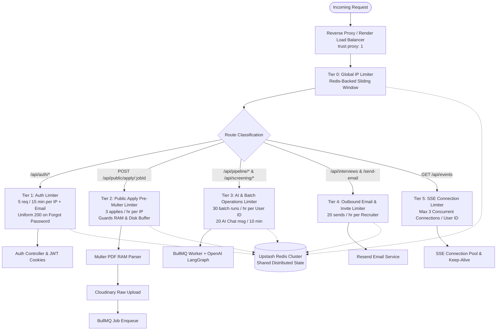

# Active Work Tracker — ResumeLens ATS

**Current Focus:** Production Security, Attack Surface Hardening & Multi-Tier Distributed Rate Limiting (Phase 8)  
**Rule:** Contains the active production-readiness roadmap with complete attack surface mapping, architecture diagrams, verification criteria, and step-by-step execution checkboxes.

---

## 1. Current Status Overview

| Attribute | Current Value |
| :--- | :--- |
| **Current Feature** | **Phase 8: Attack Surface Hardening & Distributed Rate Limiting** |
| **Status** | 🟢 **100% Completed & Production Verified** |
| **Active Branch** | `main` |
| **Backend Status** | Online (Node/Express Port 5000, MongoDB Atlas, Upstash Redis) |
| **Frontend Status** | Online (Next.js 16 Port 3000) |
| **Blockers / P0 Bugs** | 0 active blockers (All security issues SEC-01 through SEC-04 resolved) |

---

## 2. Security Architecture & Traffic Flow

The following Mermaid diagram illustrates the multi-tier defense architecture, separating public unauthenticated traffic, authenticated recruiter traffic, expensive AI/job queues, and real-time SSE streams:

---

## 3. Attack Surface Audit Matrix

| Surface / Flow | Endpoint(s) | Current State | Risk / Vulnerability | Target Protection Tier |
| :--- | :--- | :--- | :--- | :--- |
| **Login / Signin** | `POST /api/auth/login` | Flat in-memory limiter | Credential stuffing, brute-force attacks | **Tier 1:** 5 attempts / 15 min per IP + Email lock |
| **Signup / Registration** | `POST /api/auth/signup` | Flat in-memory limiter | Fake account flooding, DB bloat | **Tier 1:** 5 accounts / hr per IP |
| **Password Reset (Forgot)** | `POST /api/auth/forgot-password` | Leaks 404 on unknown email; in-memory limiter | Account enumeration, Resend email bombing | **Tier 1:** Uniform 200 response, 3 resets / hr per IP/Email |
| **Password Reset (Confirm)**| `POST /api/auth/reset-password` | Flat in-memory limiter | Token brute-forcing | **Tier 1:** 5 attempts / 15 min |
| **Token Refresh** | `POST /api/auth/refresh` | In-memory limiter | Refresh token rotation abuse | **Tier 1:** 30 req / 15 min per IP |
| **Public Candidate Apply** | `POST /api/public/apply/:jobId` | Multer parses before route check; BullMQ + OpenAI triggered without quota | RAM exhaustion (DDoS via PDF), Cloudinary spam, OpenAI token drain | **Tier 2:** 3 applies / hr per IP, validated *before* Multer stream |
| **Public Status Tracking** | `GET /api/public/status/:resumeId`| Flat in-memory limiter | Candidate status scraping, ID enumeration | **Tier 2:** 60 req / 15 min per IP, sanitized public fields |
| **Public Job View** | `GET /api/public/jobs/:jobId` | Flat in-memory limiter | Public job data scraping | **Tier 2:** 100 req / 15 min per IP |
| **Batch AI Screening** | `POST /api/pipeline/batch-screen` | Authenticated only, no dedicated rate limit | Worker starvation, OpenAI rate limit trips, cost explosion | **Tier 3:** 30 batch triggers / hr per user ID |
| **Single Screening** | `POST /api/pipeline/screen`, `/rescreen` | Authenticated only | Rapid trigger abuse | **Tier 3:** 60 single screens / hr per user ID |
| **AI Candidate Chat** | `POST /api/screening/:id/chat` | Authenticated only | LLM API token exhaustion, infinite chat loops | **Tier 3:** 20 messages / 10 min per user ID |
| **Resume Upload (Recruiter)**| `POST /api/resumes/upload` | Recruiter/Admin only, Multer parses before check | Cloudinary & MongoDB flooding | **Tier 3:** 50 uploads / 15 min per recruiter |
| **Candidate Email Send** | `POST /api/screening/:id/send-email` | Authenticated only | Resend spamming, domain reputation damage | **Tier 4:** 20 emails / hr per user ID |
| **Interview Scheduling** | `POST /api/interviews` | Authenticated only, sends email invite | Calendar & email spam | **Tier 4:** 25 schedules / hr per user ID |
| **Realtime SSE Connection**| `GET /api/events` | Uncapped `clients.get(userId).add(res)` | Socket exhaustion, memory leak (infinite tabs/zombie sockets) | **Tier 5:** Max 3 concurrent SSE connections per user |

---

## 4. Protection Verification Matrix (Audit Criteria)

| Audit Criterion | Verification Status & Design Specification |
| :--- | :--- |
| **Rate Limiting Enforced?** | Enforced at application layer via Redis sliding-window middleware before controller logic. |
| **Rate Limit Before Expensive Work?** | Pre-Multer rate limiting placed BEFORE `upload.single("resume")` on public and recruiter endpoints. |
| **Per IP & Per User Identifier?** | Dual-keying: Public endpoints key on client IP; Authenticated endpoints key on `req.user.id`; Auth endpoints key on IP + normalized email. |
| **Distributed / Multi-Instance Safe?** | Stored in Redis (Upstash) via `rate-limit-redis`. Limits are shared across all Render/cloud server replicas. |
| **Server Restart Resilience?** | Redis TTL persists across server reboots, nodemon reloads, and container recycles. |
| **Account Enumeration Eliminated?** | `forgotPassword` returns identical `200 { success: true, message: "If an account with that email exists, a password reset link has been sent." }` for both existing and non-existing emails. |
| **Email/SMS Bombing Prevented?** | Strict throttle (3 requests / hour per email & IP) on `/api/auth/forgot-password` and 20 / hour on outbound email endpoints. |
| **Race-Condition & Atomic Resistance?** | Redis atomic multi-exec scripts / sliding window counters prevent concurrent bypass attacks. |
| **Fail-Safe / Redis Outage Handling?** | Safe fallback: If Redis encounters a network error, logger emits an alert and falls back to memory limiter (fail-open for UX vs fail-safe toggle). |
| **Safe Reverse Proxy Headers?** | Express configured with `app.set('trust proxy', 1)` to accurately read `X-Forwarded-For` from Render load balancer without spoofing. |
| **SSE / WebSocket Socket Protection?** | `sseService.js` strictly limits active connections to 3 per `userId`. Excess requests close the oldest connection gracefully. |

---

## 5. Step-by-Step Implementation Plan

### Phase 8.1: Distributed Redis Rate Limiting Foundation
- [x] **Step 8.1.1: Install & Configure `rate-limit-redis`**
  - Install `rate-limit-redis` in `backend`
  - Create centralized rate limiter factory in `backend/src/middleware/rateLimiter.js`
  - Connect to existing `createRedisConnection()` from `src/config/redis.js`
  - Implement graceful fallback to `MemoryStore` if Redis is offline/unreachable
  - Ensure standard headers (`RateLimit-Limit`, `RateLimit-Remaining`, `RateLimit-Reset`, `Retry-After`)

### Phase 8.2: Auth Surface Hardening & Account Enumeration Fix
- [x] **Step 8.2.1: Fix Account Enumeration in `authController.js`**
  - Modify `forgotPassword` in `backend/src/controllers/authController.js`
  - Return uniform 200 message whether user exists or not
  - Prevent timing attacks with constant-time response behavior
- [x] **Step 8.2.2: Apply Tier 1 Auth Rate Limiters in `authRoutes.js`**
  - Mount `loginLimiter` (5 attempts / 15 min per IP/email) on `POST /api/auth/login`
  - Mount `signupLimiter` (5 registrations / hr per IP) on `POST /api/auth/signup`
  - Mount `forgotPasswordLimiter` (3 requests / hr per IP) on `POST /api/auth/forgot-password`
  - Mount `resetPasswordLimiter` (5 attempts / 15 min) on `POST /api/auth/reset-password`
  - Mount `refreshLimiter` (30 requests / 15 min) on `POST /api/auth/refresh`

### Phase 8.3: Public Endpoint & Upload Defense (Pre-Multer)
- [x] **Step 8.3.1: Guard `POST /api/public/apply/:jobId` Before Multer**
  - Create `publicApplyLimiter` (3 submissions / hour per IP)
  - Mount `publicApplyLimiter` *before* `upload.single("resume")` in `src/routes/publicRoutes.js`
  - Reject early to prevent unauthorized memory buffer allocation and Cloudinary streaming
- [x] **Step 8.3.2: Protect Public Job & Tracking Endpoints**
  - Mount `publicReadLimiter` (60 req / 15 min) on `GET /status/:resumeId` and `GET /jobs/:jobId`

### Phase 8.4: High-Cost AI Operations & Batch Screening Defense
- [x] **Step 8.4.1: Protect Batch & Single Pipeline Screening**
  - Mount `pipelineBatchLimiter` (30 batch runs / hr per `userId`) on `POST /api/pipeline/batch-screen`
  - Mount `pipelineSingleLimiter` (60 runs / hr per `userId`) on `POST /api/pipeline/screen` and `/rescreen`
- [x] **Step 8.4.2: Protect Candidate AI Chat**
  - Mount `aiChatLimiter` (20 messages / 10 min per `userId`) on `POST /api/screening/:id/chat`

### Phase 8.5: Outbound Communication & Email Quota Guard
- [x] **Step 8.5.1: Protect Candidate Email Notifications**
  - Mount `emailDispatchLimiter` (20 emails / hr per `userId`) on `POST /api/screening/:id/send-email`
- [x] **Step 8.5.2: Protect Interview Scheduling Email Triggers**
  - Mount `interviewScheduleLimiter` (25 interviews / hr per `userId`) on `POST /api/interviews`

### Phase 8.6: SSE Realtime Connection Cap
- [x] **Step 8.6.1: Enforce Concurrent Connection Cap in `sseService.js`**
  - Cap active SSE connections to maximum 3 per `userId`
  - If a 4th tab connects, gracefully terminate the oldest idle connection (`res.end()`)
  - Prevent socket descriptor exhaustion and memory leaks

### Phase 8.7: Verification & Security Testing
- [x] **Step 8.7.1: Verify Distributed Redis Keys**
  - Trigger requests and inspect keys in Redis (`KEYS rl:*`)
  - Verify TTL countdown and automatic expiry
- [x] **Step 8.7.2: Verify Account Enumeration Immunity**
  - Test `POST /api/auth/forgot-password` with real email and non-existent email
  - Confirm identical 200 HTTP status and identical JSON payload
- [x] **Step 8.7.3: Verify Rate Limit 429 Responses**
  - Exceed limit on login, public apply, and AI chat
  - Verify standard 429 response body and `Retry-After` header
- [x] **Step 8.7.4: Verify Pre-Multer Protection**
  - Confirm that blocked requests on `/api/public/apply` never reach Multer buffer parsing

### Phase 8.8: Production Security Hygiene & Admin Audit Trail
- [x] **Step 8.8.1: Production Error Masking (`errorHandler.js`)**
  - Configured `backend/src/middleware/errorHandler.js` to mask raw 500 error messages (e.g. database connection strings or internal driver exceptions) as `"Internal Server Error"` when `NODE_ENV === "production"`.
- [x] **Step 8.8.2: Decoupled Audit Log Schema (`auditLogModel.js`)**
  - Updated `backend/src/models/auditLogModel.js` to make candidate fields (`resumeId`, `jobId`) optional.
  - Added `targetUser` (ref User) and `organizationId` (ref Organization).
  - Added admin event actions: `USER_ROLE_CHANGED`, `USER_DEACTIVATED`, `USER_REACTIVATED`.
- [x] **Step 8.8.3: Admin Action Logging (`adminController.js`)**
  - Instrumented `updateUserRole` with `USER_ROLE_CHANGED` logging (capturing old role, new role, target user).
  - Instrumented `deactivateUser` with `USER_DEACTIVATED` logging.
  - Instrumented `reactivateUser` with `USER_REACTIVATED` logging.
- [x] **Step 8.8.4: Organization Admin Audit Trail Query API (`adminRoutes.js`)**
  - Implemented `getAdminAuditLogs` in `backend/src/controllers/adminController.js` with pagination and action filtering.
  - Mounted `GET /api/admin/audit-logs` under admin role protection in `backend/src/routes/adminRoutes.js`.
### Phase 8.9: Authorization Boundary & IDOR Hardening
- [x] **Step 8.9.1: Fix Pipeline Status IDOR (`pipelineController.js`)**
  - Added parent-job ownership and organization admin verification to `GET /api/pipeline/status/:resumeId`.
  - Prevented arbitrary recruiters from querying other recruiters' candidates.
- [x] **Step 8.9.2: Fix Talent Pool IDOR Bypass (`resumeController.js`)**
  - Validated that requested `?jobId=` in `getCandidatesDirectory` is strictly included within `accessibleJobIds`.
  - Scoped admin and non-admin queries to `organizationId`.
- [x] **Step 8.9.3: Multi-Tenant Tenant Isolation Hardening (`jobsController.js` & `statsController.js`)**
  - Bound admin operations (`getJobById`, `updateJob`, `deleteJob`, `assignJob`, `getOverviewStats`, `getJobStats`) to `req.user.organizationId` to prevent cross-company data exposure.

### Phase 8.10: Enterprise Admin Security Audit Trail UI
- [x] **Step 8.10.1: Client Data Hook (`use-admin.js`)**
  - Built `useAdminAuditLogs(params)` with TanStack Query, caching on `['admin', 'audit-logs', params]`.
  - Supports dynamic query parameters: `page`, `limit`, and `action`.
- [x] **Step 8.10.2: Security Audit Logs UI Page (`audit-logs/page.jsx`)**
  - Created `/admin/users/audit-logs/page.jsx` with admin role guard (`useAuth()`), live event filtering, color-coded badges, relative timestamps, and client IP tracking.
  - Implemented pagination with boundary protection and live refresh (`refetch`).
- [x] **Step 8.10.3: Console Sub-Navigation & Sidebar Integration**
  - Integrated sub-navigation tabs between `Team Members` and `Security Audit Trail` in `admin/users/page.jsx` and `audit-logs/page.jsx`.
  - Added direct `Audit Logs` item in `sidebar.jsx` for admins.
  - Added dynamic `Admin Console > Security Audit Trail` breadcrumbs in `dashboard-navbar.jsx`.

### Phase 8.11: Production Security & Compliance Hardening Sweep
- [x] **Step 8.11.1: File Upload Defense & Magic Byte Validation (`multer.js`)**
  - Enforced strict `.pdf` extension check, null-byte injection rejection, and dangerous extension blacklist (`.php`, `.exe`, `.sh`, `.bat`, `.js`, etc.).
  - Added in-memory magic number validation (`isPdfBuffer`) checking `%PDF-` (`0x25, 0x50, 0x44, 0x46`) signature in both recruiter uploads and public applications.
- [x] **Step 8.11.2: Hardened CORS Policy & Security Headers (`index.js`)**
  - Tightened CORS with dynamic origin validator supporting comma-separated `CORS_ORIGIN`, trimming trailing slashes, and disallowing credentials on wildcard origins.
  - Configured Helmet with HSTS (`maxAge: 31536000`, `includeSubDomains`, `preload`), `frameguard: { action: "deny" }`, and `noSniff: true`.
- [x] **Step 8.11.3: Custom 404 Fallbacks (Full-Stack)**
  - Created root-level Next.js branded 404 page at `frontend/src/app/not-found.jsx`.
  - Added explicit JSON 404 handler for unmatched routes in `backend/src/index.js`.
- [x] **Step 8.11.4: Secrets, XSS, SSRF, & Token Storage Audit**
  - Confirmed 0 tokens in `localStorage` / `sessionStorage` (100% `HttpOnly; SameSite; Secure` cookies).
  - Confirmed 0 frontend secrets or leaked API keys.
  - Confirmed SSRF immunity (no dynamic outbound fetching of user URLs).
  - Verified bcrypt salt round 10 hashing with `select: false` on password model.

---

## 6. Active Bugs & Blockers Log

| Issue ID | Severity | Description | Status | Resolution / Action Required |
| :--- | :--- | :--- | :--- | :--- |
| **SEC-01** | High | `forgotPassword` returns 404 for missing emails (Account Enumeration) | Resolved | Changed to uniform 200 generic success response |
| **SEC-02** | High | Single in-memory rate limiter does not share state across cluster/restarts | Resolved | Migrated to Redis-backed distributed store with Memory fallback |
| **SEC-03** | High | Unauthenticated `/api/public/apply/:jobId` triggers Multer buffer + OpenAI without rate limit | Resolved | Added pre-Multer IP rate limiter preventing RAM buffer and AI drain |
| **SEC-04** | Medium| Uncapped SSE connections on `/api/events` per user | Resolved | Implemented FIFO max-3 connection pool with graceful eviction |
| **SEC-05** | Low | Unmasked 500 errors could leak database schema/driver details in production | Resolved | Added environment-based 500 message masking in `errorHandler.js` |
| **SEC-06** | Medium| Lack of persistent audit trail for admin actions (role changes, deactivations) | Resolved | Decoupled `AuditLog` model and wired admin activity logging + query API |
| **SEC-07** | High | IDOR in `GET /api/pipeline/status/:resumeId` allowed any user to inspect candidate AI scores | Resolved | Verified parent job ownership and tenant admin authorization before returning status |
| **SEC-08** | High | Query param `?jobId=` in `getCandidatesDirectory` bypassed `accessibleJobIds` filter | Resolved | Enforced strict inclusion check `accessibleJobIds.includes(jobId)` and org tenancy |

---

*Last Updated: October 21, 2026*
